# AutoML Studio — Plateforme MLOps de prédiction du churn

Projet universitaire de Master 2 : **conception et développement d’une
plateforme AutoML/MLOps pour entraîner, évaluer, déployer et superviser des
modèles de Machine Learning**. Le cas d’usage est la prédiction de résiliation
de clients d’un opérateur télécom à partir du dataset Telco Customer Churn.

> **État vérifié le 25 novembre 2026 :** Pytest : **20 réussis, 0 échec,
> 1 avertissement** Starlette/httpx.
> Les captures du dashboard et les résultats de prédiction ci-dessous ont été
> obtenus sur la version française mise à jour localement le 25 novembre 2026.
> Les quatre services Docker sont actifs. Les images API et dashboard ont été
> reconstruites après l’entraînement Optuna; l’API conteneurisée et le modèle
> local renvoient tous deux 0,3468 pour le même profil de contrôle.
> Le workflow GitHub Actions sera vérifié après publication. Aucun remote DVC
> n’est configuré; les données préparées et les métadonnées MLflow locales ne
> sont pas publiées dans Git.

## Présentation

Le projet automatise les principales étapes d’un workflow ML :

1. exploration et préparation des données ;
2. séparation entraînement/test sans fuite de données ;
3. comparaison de plusieurs algorithmes et sélection selon une métrique ;
4. journalisation des expériences et enregistrement du modèle dans MLflow ;
5. exposition d’une prédiction par API FastAPI ;
6. interface Streamlit et supervision avec Prometheus/Grafana ;
7. tests automatisés avec Pytest et workflow GitHub Actions.

L’objectif est de rendre le cycle de vie d’un modèle reproductible et de
présenter ses résultats dans une interface utilisable, plutôt que de livrer
uniquement un notebook d’entraînement.

## Aperçu de l’interface

Les images de cette section sont des captures réelles de la version française
du dashboard. Les nombres affichés sont ceux des artefacts présents au moment
de la capture ; ils ne constituent pas une garantie pour un nouvel entraînement.

### Vue d’ensemble

La page rassemble les indicateurs du dataset, le meilleur modèle, les essais
MLflow et l’état des services.

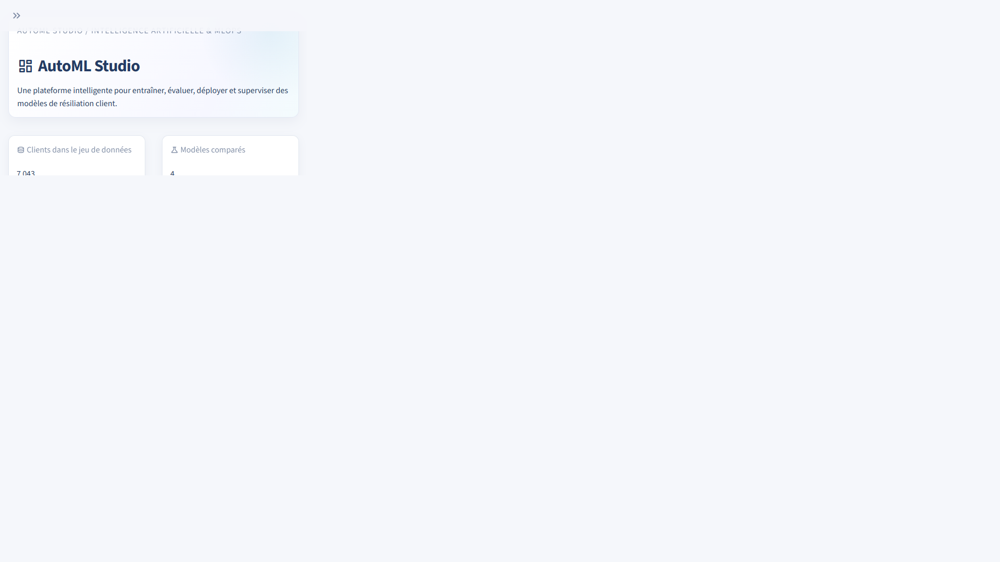

### Exploration des données et expériences

L’explorateur présente le dataset source et ses distributions. La page
Expériences compare les modèles à partir des métriques enregistrées dans MLflow.

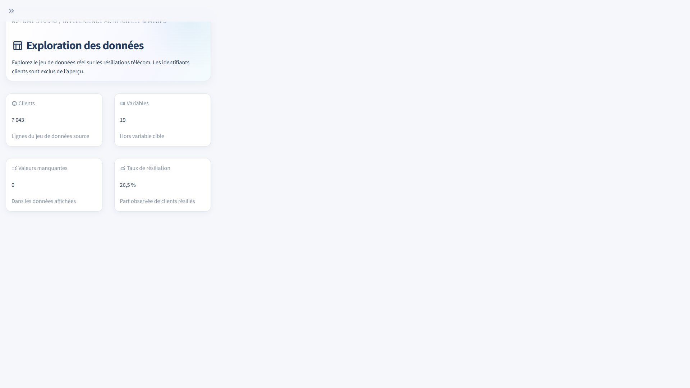

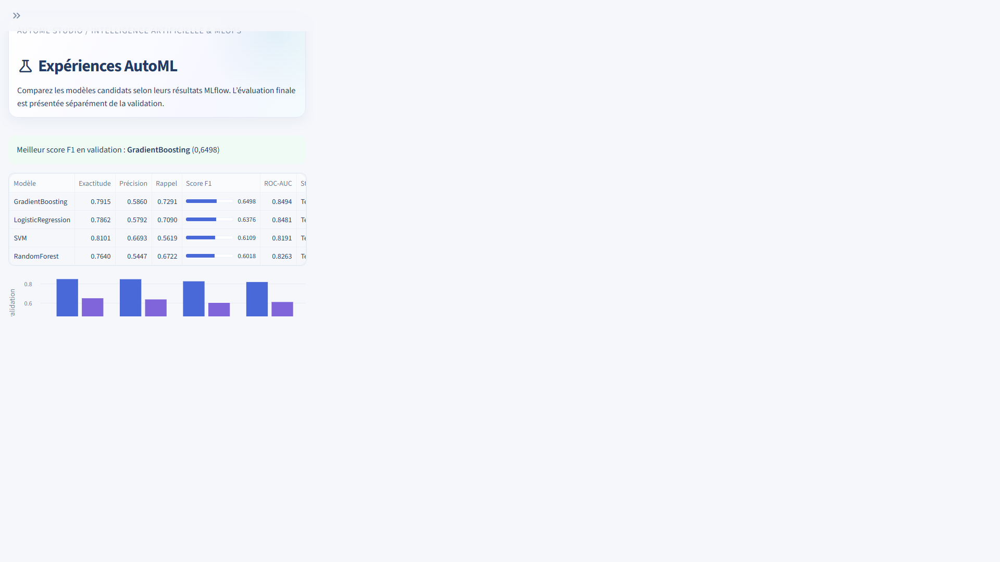

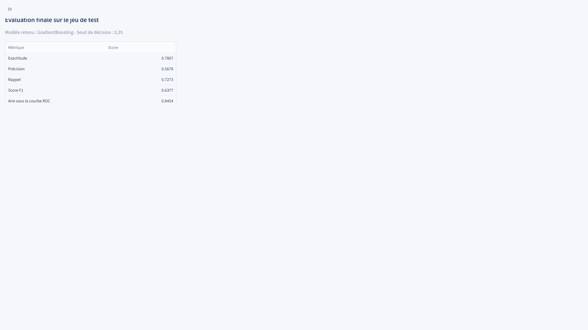

### Prédiction en direct

Le formulaire transmet un profil client à l’API FastAPI. La capture de résultat
montre une réponse réellement renvoyée par le modèle en service.

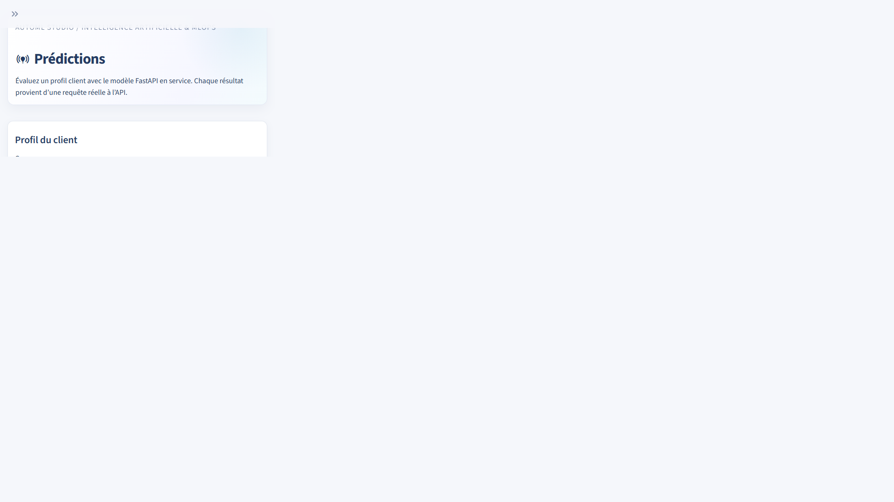

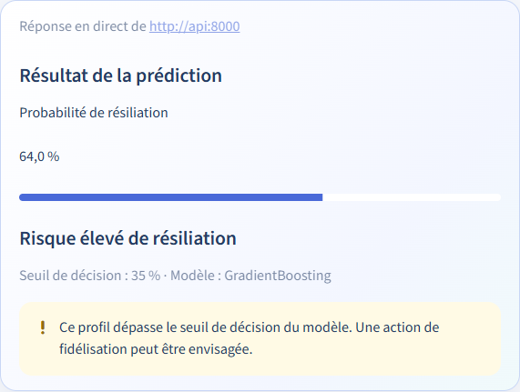

### Registre et supervision

La page Registre lit les versions présentes dans la base MLflow locale.
La page Supervision affiche les états de FastAPI, Prometheus et MLflow.

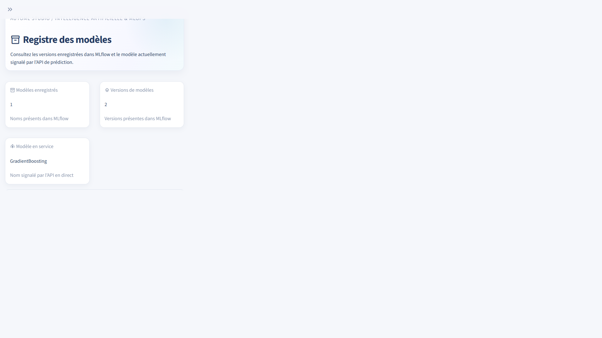

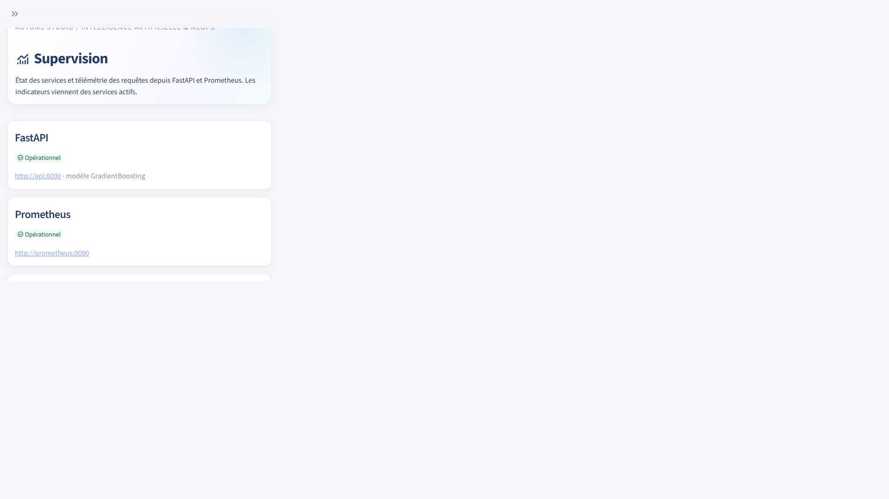

Les interfaces locales MLflow montrent les runs de l’expérience et le registre
des versions, sans impliquer qu’un serveur MLflow soit déployé par Compose.

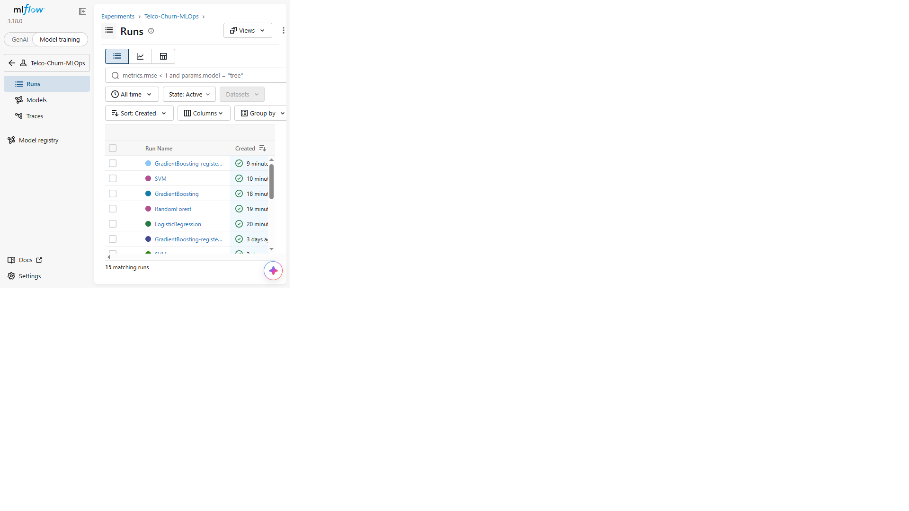

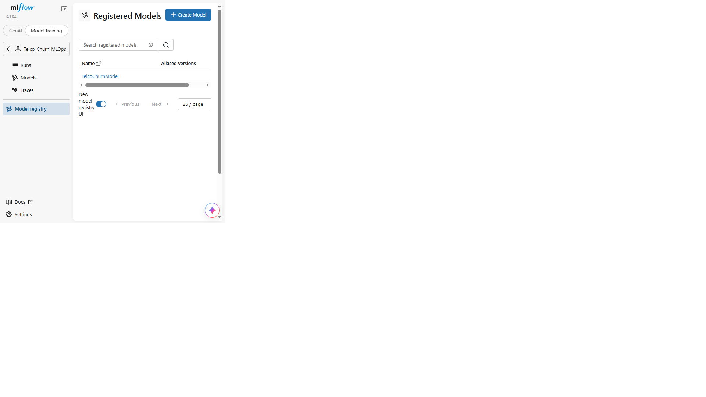

Les captures complémentaires de [Swagger](docs/screenshots/fastapi-swagger.png),
des [cibles Prometheus](docs/screenshots/prometheus-targets.png) et du
[dashboard Grafana](docs/screenshots/grafana-dashboard.png), ainsi que
l’inventaire des captures, sont dans
[docs/screenshots/](docs/screenshots/README.md).

## Architecture

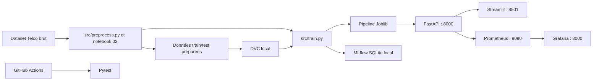

Le détail des composants et des flux est décrit dans
[docs/architecture.md](docs/architecture.md).

### Services et adresses locales

| Service | Port | Adresse |
|---|---:|---|
| Streamlit | 8501 | <http://localhost:8501> |
| FastAPI | 8000 | <http://localhost:8000> |
| Swagger / OpenAPI | 8000 | <http://localhost:8000/docs> |
| Prometheus | 9090 | <http://localhost:9090> |
| Grafana | 3000 | <http://localhost:3000> |

Compose orchestre quatre services : API, dashboard, Prometheus et Grafana.
MLflow est utilisé localement via SQLite et des artefacts locaux ; il n’existe
pas de service MLflow dans le fichier Compose actuel.

## Données et prétraitement

Le dataset brut attendu est
`data/raw/Telco-Customer-Churn.csv` (7 043 lignes × 21 colonnes). Le notebook
[`notebooks/02_data_preprocessing.ipynb`](notebooks/02_data_preprocessing.ipynb)
documente les transformations; le script
[`src/preprocess.py`](src/preprocess.py) permet de les réexécuter localement :

- séparation stratifiée entraînement/test selon une proportion 80/20 ;
- imputation et transformations adaptées aux types de variables ;
- apprentissage du préprocesseur sur le train seulement, puis application au
  train et au test ;
- encodage de la cible `Churn` en `0` et `1` ;
- export des matrices préparées et sauvegarde du préprocesseur avec Joblib.

Dimensions vérifiées : train **5 634 × 45**, test **1 409 × 45**. Les deux
matrices ne sont pas vides et les valeurs des cibles sont limitées à `0` et `1`.
Le préprocesseur est ajusté uniquement sur le jeu train, puis appliqué au test.
Le script a été exécuté dans un répertoire temporaire : ses quatre exports
étaient identiques aux fichiers préparés existants. Le prétraitement reste une
étape manuelle avant `dvc repro`; le pipeline DVC courant commence à
l’entraînement afin de conserver les pointeurs `.dvc` existants.

## Entraînement AutoML et évaluation

[`src/train.py`](src/train.py) compare quatre classifieurs scikit-learn :

- Logistic Regression ;
- Random Forest ;
- Gradient Boosting ;
- SVM.

Optuna/TPE explore dix configurations par candidat avec une validation croisée
stratifiée à trois folds sur la partition d’entraînement interne. Les quatre
candidats sont comparés sur une partition de validation distincte au F1-score
avec un seuil de 0,35. Le jeu test reste réservé à l’évaluation finale. Le
meilleur candidat est réentraîné sur l’ensemble train. Les métriques produites
sont accuracy, precision, recall, F1-score et ROC-AUC.

Résultats présents dans `reports/metrics.json` lors de la dernière validation
documentée :

| Métrique | Résultat test |
|---|---:|
| Modèle retenu | GradientBoosting |
| Seuil de décision | 0,35 |
| Accuracy | 0,7807 |
| Precision | 0,5678 |
| Recall | 0,7273 |
| F1-score | 0,6377 |
| ROC-AUC | 0,8454 |

Ces métriques dépendent des données, du code et des artefacts effectivement
entraînés. Le stage DVC journalise les paramètres et métriques Optuna dans
MLflow et exporte `reports/optuna_trials.csv` ainsi que
`reports/optuna_best_params.json`. Le notebook
[`notebooks/06_mlflow_optuna.ipynb`](notebooks/06_mlflow_optuna.ipynb)
reste une étude complémentaire. XGBoost n’a pas été retenu dans le pipeline
actif; les quatre candidats restent scikit-learn.

## DVC et MLflow

### DVC

`dvc.yaml` orchestre le stage d’entraînement et déclare ses dépendances,
artefacts finaux, métriques et résultats Optuna. Les données préparées et le
préprocesseur sont référencés par `data/processed.dvc` et
`models/preprocessor.joblib.dvc`.

**Aucun remote DVC n’est configuré, conformément au choix de stockage local.**
Les données préparées et modèles conservés dans le cache DVC local ne seront
pas récupérables par `dvc pull` sur une autre machine. Le CSV brut est suivi
dans Git et les exports peuvent être régénérés avec `python src/preprocess.py`.
Le petit artefact final `models/churn_pipeline.joblib` est également suivi dans
Git afin qu’un clone puisse construire l’image de l’API sans remote DVC; le
préprocesseur et les jeux préparés restent gérés localement par DVC. Aucun
identifiant ni remote fictif n’est inclus.

### MLflow

Le tracking et le Model Registry sont enregistrés dans une base SQLite locale
(`mlflow.db`) et les artefacts correspondants sous `mlruns/`. Après l’exécution
Optuna, la base contient 15 runs et trois versions `READY` de
`TelcoChurnModel`. Ces fichiers locaux sont exclus de Git. Aucun serveur MLflow
n’est déployé par Compose ; une nouvelle machine ne disposera pas de cet
historique sans mécanisme de partage dédié.

## API FastAPI

L’API charge le pipeline Joblib et le préprocesseur, valide les profils entrants
et renvoie la probabilité, la décision au seuil configuré, le niveau de risque
et le nom du modèle.

| Endpoint | Usage |
|---|---|
| `GET /` | Informations générales de l’API |
| `GET /health` | Santé de l’application et modèle chargé |
| `POST /predict` | Prédiction de churn pour un profil client |
| `GET /metrics` | Métriques pour Prometheus |
| `GET /docs` | Documentation interactive Swagger |

Un profil invalide est refusé avec HTTP 422 par la validation FastAPI/Pydantic.
La communication du dashboard vers l’API utilise `API_URL` (dans Compose :
`http://api:8000`).

Exemple de requête PowerShell vers une API déjà démarrée :

```powershell
$profil = @'
{
  "gender": "Female",
  "SeniorCitizen": 0,
  "Partner": "No",
  "Dependents": "No",
  "tenure": 12,
  "PhoneService": "Yes",
  "MultipleLines": "No",
  "InternetService": "DSL",
  "OnlineSecurity": "No",
  "OnlineBackup": "Yes",
  "DeviceProtection": "No",
  "TechSupport": "No",
  "StreamingTV": "No",
  "StreamingMovies": "No",
  "Contract": "Month-to-month",
  "PaperlessBilling": "Yes",
  "PaymentMethod": "Electronic check",
  "MonthlyCharges": 70.35,
  "TotalCharges": 844.2
}
'@
Invoke-RestMethod -Uri "http://localhost:8000/predict" `
  -Method Post -ContentType "application/json" -Body $profil
```

Le résultat comporte notamment `model`, `churn_probability`, `threshold`,
`churn_prediction` et `risk_label`. Les catégories doivent correspondre aux
modalités attendues du dataset.

## Dashboard Streamlit

L’interface est en français, thème clair, pensée pour un affichage sur écran ou
vidéoprojecteur et répartie en six pages :

1. **Vue d’ensemble** : indicateurs réels, modèle retenu, résultats et état des
   services ;
2. **Exploration des données** : distributions et valeurs manquantes ;
3. **Expériences AutoML** : comparaison MLflow et résultats test ;
4. **Prédictions** : formulaire client et réponse réelle de FastAPI ;
5. **Registre des modèles** : versions et modèle en service ;
6. **Supervision** : santé des services et métriques Prometheus.

La source est dans [`app/`](app/). L’interface de prédiction ne remplace pas
l’API par une simulation : le profil soumis est envoyé au service FastAPI.

## Monitoring

Prometheus collecte les métriques exposées par FastAPI sur
`api:8000/metrics`. La cible `automl-api` a été vérifiée `up=1`. Grafana est
provisionné avec une source Prometheus et un dashboard API. Le dashboard a été
ouvert après authentification et une capture réelle est disponible dans
[`docs/screenshots/grafana-dashboard.png`](docs/screenshots/grafana-dashboard.png).

## Tests et état de validation

Exécuter les tests depuis la racine du dépôt :

```powershell
.\.venv\Scripts\python.exe -m pytest tests/ -v
```

Dernier résultat rejoué le 24 novembre 2026 :
**18 passed, 0 failed, 1 warning**
(`StarletteDeprecationWarning` concernant l’usage de `httpx` avec
`starlette.testclient`). Les tests couvrent les routes API, les six pages
Streamlit, l’appel de prédiction, les comportements de graphiques, le
prétraitement, une recherche Optuna représentative et la préservation des noms
de variables transformées à la prédiction.

Autres vérifications documentées :

- `dvc status` et `dvc repro` : pipeline local à jour ;
- `docker compose config --quiet` : configuration Compose valide ;
- API root, health et metrics, dashboard, Prometheus health et Grafana health :
  HTTP 200 au dernier contrôle local ;
- prédiction API réelle : HTTP 200 ; target Prometheus `automl-api` : `up` ;
- avertissements Vega non bloquants observés pour certains graphiques lors
  d’un premier rendu ; accès direct aux sous-pages a également exposé des 404
  sur des sondes internes Streamlit, tandis que la navigation de l’application
  a été testée sans réponse 4xx/5xx.

Les preuves et détails des commandes sont dans
[docs/tests.md](docs/tests.md). La CI est définie dans
[.github/workflows/ci.yml](.github/workflows/ci.yml), mais aucun run GitHub
Actions distant n’a été vérifié.

## Installation et lancement local

Voir le guide détaillé [docs/installation.md](docs/installation.md). Prérequis :
Python 3.11 pour le développement et Docker Desktop avec Compose v2 pour le
lancement conteneurisé.

```powershell
# Environnement Python local
py -3.11 -m venv .venv
.\.venv\Scripts\Activate.ps1
python -m pip install --upgrade pip
python -m pip install -r requirements.txt

# Régénérer les données préparées et le préprocesseur à partir du CSV brut
.\.venv\Scripts\python.exe src\preprocess.py

# Contrôler et exécuter le stage DVC après la préparation des données
.\.venv\Scripts\dvc.exe status
.\.venv\Scripts\dvc.exe repro

# Vérifier puis démarrer les quatre services
docker compose config
docker compose up -d
docker compose ps

# Exécuter les tests locaux
.\.venv\Scripts\python.exe -m pytest tests/ -v
```

Pour reconstruire l’API et le dashboard après une modification du modèle ou
du code, vérifier d’abord l’espace disque :

```powershell
docker compose build api dashboard
docker compose up -d --no-deps api dashboard
```

Ces commandes ont été exécutées pour aligner les conteneurs sur les artefacts
locaux; elles ne suppriment pas les volumes. Elles ne concernent que l’API et
le dashboard, sans reconstruire Prometheus ou Grafana. Aucun déploiement cloud,
stockage DVC distant ou service payant n’est configuré.

## Captures d’écran

Les captures finales conservées sont listées dans
[docs/screenshots/README.md](docs/screenshots/README.md). Les six captures
historiques des tests sont gardées dans `screenshots/tests/` et sont identifiées
comme historiques; elles ne doivent pas être présentées comme l’interface
finale actuelle.

## Limites et prochaines étapes

- Configurer un remote DVC choisi et autorisé si les données doivent être
  récupérables depuis une autre machine.
- Le prétraitement est reproductible via `src/preprocess.py`, mais reste une
  étape locale manuelle avant `dvc repro`, afin de préserver les pointeurs DVC
  existants.
- MLflow est local, sans serveur Compose ni stockage partagé.
- Les conteneurs vérifiés servent le modèle et les métriques actuels; les
  empreintes des fichiers dans l’API et le dashboard correspondent aux
  artefacts locaux.
- Des avertissements non bloquants restent à examiner : Vega au premier rendu,
  dépréciation Starlette/httpx, dépréciation de `SVC(probability=True)` et
  avertissement MLflow sur le chargement d’artefacts sérialisés.
- Compléter les captures de l’architecture, du prétraitement, de Pytest et des
  conteneurs. La capture GitHub Actions dépend du workflow après publication.

Aucun commit, push, merge ou publication distante n’est déclenché par les
commandes ci-dessus. Voir le
[rapport de conformité](docs/rapport-final.md) pour l’état des exigences du
cadrage.
