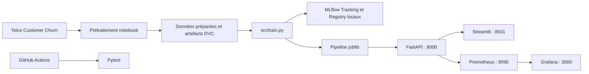

# AutoML & MLOps — Telco Customer Churn

Plateforme de Master 2 pour préparer des données, comparer des modèles de
résiliation client, suivre les expériences, exposer une prédiction par API et
superviser le service.

> **État local vérifié le 23 novembre 2026 :** les quatre services Docker sont
> actifs et le dashboard français a été reconstruit puis vérifié sur
> `localhost:8501`. Une prédiction réelle depuis Streamlit et l’API a réussi.
> Aucun remote DVC n’est configuré ; les données et artefacts uniquement locaux
> ne sont pas récupérables depuis un stockage distant. Le rendu Grafana n’a pas
> été validé dans son interface faute d’accès authentifié fourni.

## Problématique et objectifs

Un pipeline ML réalisé manuellement est difficile à reproduire et à exploiter.
Ce projet automatise le cas d’usage de prédiction du churn télécom : préparer
les données, comparer plusieurs algorithmes, sélectionner un modèle, tracer les
expériences, servir des prédictions et observer l’API.

## Architecture



Le détail des composants se trouve dans [docs/architecture.md](docs/architecture.md).

## Technologies et fonctionnalités

- Python 3.11, pandas, scikit-learn et Joblib.
- DVC pour les données préparées et les artefacts du pipeline d’entraînement.
- MLflow avec une base SQLite locale pour les runs et le Model Registry.
- FastAPI pour l’API de prédiction et ses métriques Prometheus.
- Streamlit pour six pages : vue d’ensemble, exploration des données,
  expériences AutoML, prédictions, registre des modèles et supervision.
- Docker Compose pour l’API, le dashboard, Prometheus et Grafana.
- Pytest et GitHub Actions pour les tests.

Le notebook [notebooks/06_mlflow_optuna.ipynb](notebooks/06_mlflow_optuna.ipynb)
documente une recherche Optuna distincte. Cette recherche n’est pas intégrée au
stage `train_and_register` de `dvc.yaml`. Le pipeline actif compare actuellement
Logistic Regression, Random Forest, Gradient Boosting et SVM.
XGBoost figure parmi les technologies envisagées dans le cadrage, mais n’est pas
installé ni utilisé dans le pipeline courant.

## Prétraitement et entraînement

Le notebook `02_data_preprocessing.ipynb` sépare les variables train/test de
façon stratifiée (80/20), ajuste les imputeurs, le scaler et le OneHotEncoder
uniquement sur le train, puis applique le préprocesseur au test. Les artefacts
locaux observés contiennent :

- train : 5 634 lignes ;
- test : 1 409 lignes ;
- 45 variables encodées ;
- cible numérique `Churn` limitée à `0` et `1`.

`src/train.py` compare les quatre modèles sur une validation interne, sélectionne
le meilleur selon le F1, le réentraîne sur tout le jeu train, puis évalue une
seule fois sur le jeu test. Le rapport local observé est dans
`reports/metrics.json` : GradientBoosting, seuil 0,35, accuracy 0,7764,
precision 0,5626, recall 0,7086, F1 0,6272 et ROC-AUC 0,8434. Ces nombres
décrivent les artefacts présents au moment du contrôle et ne sont pas une
garantie de résultat pour une exécution ultérieure.

## DVC et MLflow

`dvc.yaml` orchestre le stage d’entraînement ; `data/processed.dvc` et
`models/preprocessor.joblib.dvc` suivent des artefacts locaux. `dvc status`
indique que les données et le pipeline locaux sont à jour. Aucun remote DVC
n’est défini : une nouvelle machine ne peut pas récupérer ces artefacts par DVC.
Ne configurez pas de remote sans choisir et autoriser explicitement un stockage.

MLflow utilise `mlflow.db` et `mlruns/` locaux. La base présente lors de l’audit
contenait 10 runs, quatre candidats et deux versions `READY` de
`TelcoChurnModel`. Elle n’est pas un serveur MLflow distant et ces fichiers sont
ignorés par Git.

## API et interface

- API : `http://localhost:8000` ; documentation Swagger :
  `http://localhost:8000/docs`.
- Dashboard : `http://localhost:8501`.
- Prometheus : `http://localhost:9090`.
- Grafana : `http://localhost:3000`.

L’API accepte un profil client, applique le préprocesseur sauvegardé et renvoie
une probabilité, une décision au seuil configuré et le nom du modèle. Le
dashboard français actuellement exposé sur le port 8501 appelle cette API ; les
six pages ont été parcourues et une prédiction réelle a été affichée.

## Installation et exécution

Consultez [docs/installation.md](docs/installation.md) avant l’exécution.
Commandes usuelles :

```powershell
docker compose config
docker compose up -d
docker compose ps
```

Pour une prochaine mise à jour de l’interface, reconstruire uniquement le
dashboard puis recréer son conteneur :

```powershell
docker compose build dashboard
docker compose up -d --no-deps dashboard
```

Ces commandes ont été utilisées pour le dashboard le 23 novembre 2026. Elles ne
ciblent pas les autres services ou volumes ; aucun nettoyage Docker, suppression
d’image ou suppression de volume n’a été effectué.

## CI, tests et monitoring

L’action [ci.yml](.github/workflows/ci.yml) installe `requirements.txt` et lance
Pytest. La suite locale compte 15 tests réussis, aucun échec et un avertissement
de dépréciation Starlette/httpx. Les vérifications API/DVC et les avertissements
Vega observés sont consignés dans [docs/tests.md](docs/tests.md). Prometheus scrappe
`api:8000/metrics` ; Grafana est provisionné avec la source Prometheus et un
dashboard API.

## Captures et limites

Les captures de la version déployée (six pages, formulaire et résultat réel)
ainsi que Swagger et les cibles Prometheus sont enregistrées dans
`docs/screenshots/`. Les captures de la version antérieure sont conservées dans
`screenshots/tests/`. Les vues Grafana, MLflow Tracking, Pytest, Docker et le
prétraitement restent à documenter par des captures authentiques ; GitHub
Actions attend l’autorisation de publication. Le tableau des captures est dans
[docs/screenshots/README.md](docs/screenshots/README.md).

Autres limites connues : l’optimisation Optuna reste séparée du pipeline DVC ;
le prétraitement s’exécute depuis un notebook et n’est pas un stage DVC ; aucun
remote de données, serveur MLflow ni résultat CI distant n’a été vérifié.

## Documentation

- [Architecture](docs/architecture.md)
- [Installation](docs/installation.md)
- [Tests et preuves](docs/tests.md)
- [Rapport de conformité local](docs/rapport-final.md)