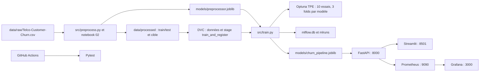

# Architecture de la plateforme

## Vue générale

## Composants

| Composant | Rôle | Preuve locale |
|---|---|---|
| Prétraitement | Nettoyage, séparation stratifiée, apprentissage du préprocesseur sur train uniquement, encodage et export CSV/Joblib | `src/preprocess.py`, `notebooks/02_data_preprocessing.ipynb` |
| DVC | Suivi local des données préparées, du préprocesseur et du stage d’entraînement | `dvc.yaml`, `dvc.lock`, `data/processed.dvc`, `models/preprocessor.joblib.dvc` |
| Entraînement AutoML | Comparaison de quatre classifieurs; Optuna/TPE, 10 essais, validation croisée à trois folds; sélection par F1 de validation et évaluation finale sur test | `src/train.py`, `reports/metrics.json`, `reports/optuna_trials.csv`, `reports/optuna_best_params.json` |
| MLflow | Runs, paramètres, métriques, modèles enregistrés et versions | `mlflow.db`, `mlruns/` (locaux et ignorés par Git) |
| API | Chargement du pipeline Joblib, prédiction et métriques HTTP | `src/api/main.py`, `src/predict.py` |
| Interface | Six pages Streamlit en français dans la source actuelle | `app/streamlit_app.py`, `app/app_pages/` |
| Monitoring | Scrape Prometheus de FastAPI et dashboard provisionné Grafana | `prometheus.yml`, `monitoring/grafana/` |
| CI | Installation des dépendances et exécution Pytest sur push/PR | `.github/workflows/ci.yml` |

## Flux de prédiction

1. Streamlit construit un profil client avec les modalités attendues par le
   modèle.
2. Le dashboard envoie le profil à `POST /predict`.
3. FastAPI valide le corps JSON, transforme le profil avec le préprocesseur
   sauvegardé, puis calcule la probabilité avec le modèle servi.
4. L’API renvoie le modèle, la probabilité, le seuil, la décision et le niveau
   de risque.
5. L’instrumentateur FastAPI expose les mesures à `/metrics`.
6. Prometheus scrappe `api:8000` toutes les cinq secondes ; Grafana interroge
   Prometheus.

## Portée et limites

- Le prétraitement dispose maintenant d’un script réexécutable, mais reste
  une commande manuelle avant `dvc repro` afin de conserver les pointeurs DVC
  `.dvc` déjà suivis.
- Optuna est intégré au stage DVC actif; le notebook 06 reste une étude
  complémentaire consacrée au SVM.
- La base MLflow et ses artefacts sont locaux ; aucun serveur ou stockage
  distant n’est configuré.
- Aucun remote DVC n’est configuré par choix; les données préparées peuvent
  être régénérées localement à partir du CSV brut suivi par Git.
- `docker-compose.yml` utilise `depends_on` avec `service_started`, sans
  healthchecks Docker dédiés.
- Le conteneur Streamlit a été reconstruit pour servir la source française ;
  les quatre services Compose étaient actifs lors du contrôle.
- Les sondes Prometheus sont visibles dans l’interface Supervision. Le dashboard
  Grafana a été ouvert avec une session authentifiée et capturé dans
  `docs/screenshots/grafana-dashboard.png`.
